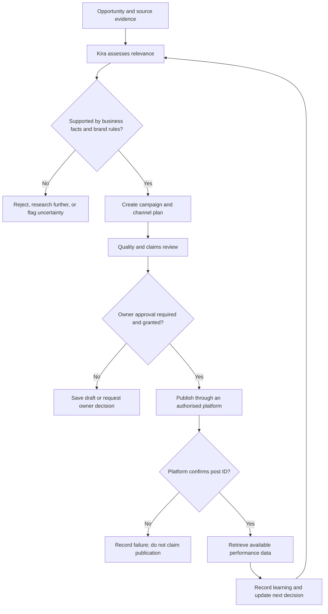
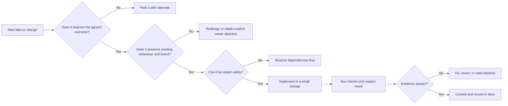

# Marketing Genius Command Centre — Build Diary

**Repository:** `lucasmaxxinfo-sketch/marketer`  
**Purpose:** A chronological, human-readable record of project decisions, implementation work, tests, failures, fixes and deployments.

This diary is the project narrative. Git commits remain the authoritative record of code changes; GitHub Actions and deployment checks remain the evidence for build and release outcomes. The diary links those records where possible and never labels unverified work as complete.

## How entries are recorded

Each entry should state:
- **Date and time:** Include the project timezone when known.
- **Objective:** What the work is intended to achieve.
- **Work performed:** What actually changed.
- **Evidence:** Commit, pull request, workflow run, test output or deployment URL.
- **Result:** Verified, partial, blocked or not yet tested.
- **Next action:** The next concrete step.

Record meaningful decisions and implementation milestones, not every trivial edit. Note regressions and their resolution rather than silently erasing them. Never put passwords, API keys, access tokens or other secrets in this diary.

---

## 2026-11-06 — Project management and baseline audit

**Objective:** Establish one continuous build record and identify the real state of the existing application before changing it.

**Work performed:**
- Confirmed the existing repository: [lucasmaxxinfo-sketch/marketer](https://github.com/lucasmaxxinfo-sketch/marketer).
- Inspected the existing frontend, cinematic styling, Kira character and voice files, PWA files, backend Worker and deployment workflow definitions.
- Confirmed the established cosmic/Kira creative direction must be preserved. A replacement generic dashboard is explicitly out of scope.
- Created [docs/BUILD-STATUS.md](./BUILD-STATUS.md), documenting the repository inventory, conditional capabilities, known implementation gaps and staged delivery sequence.
- Committed the audit as [e542164](https://github.com/lucasmaxxinfo-sketch/marketer/commit/e54216435ae7e019e1cb17638bf0aa4de13fd5e5).

**Findings from source inspection:**
- The frontend contains campaign, review, planning, business setup and local draft workflows.
- The Worker defines owner authentication, campaign storage endpoints, AI chat/strategy/generation, Facebook and Instagram publishing, and limited Facebook insights.
- Several live capabilities depend on Cloudflare Worker configuration and secrets. The tracked Wrangler configuration contains a KV namespace placeholder; the deployment workflow may inject configuration at runtime, which cannot be confirmed from source inspection alone.
- The Worker publishing code requires explicit owner approval. Its supported publishing paths are currently Facebook Page feed posts and Instagram feed image posts.
- Timed autonomous publishing, TikTok publishing, Google Business Profile publishing and broad cross-platform analytics are not established by the inspected Worker code.

**Result:** Baseline source audit recorded and committed. This is not a live deployment or end-to-end functionality test. Production service health, credentials, connected accounts and actual publishing remain unverified.

**Next action:** Verify the deployed Pages site and Worker health endpoint, then test secure owner login, AI generation, cloud persistence and publishing in a controlled environment. Record actual workflow results and evidence here.

---

## 2026-11-06 — Visual architecture and decision governance added

**Objective:** Make the build diary useful as a project-management instrument, not just a list of dated notes.

**Work performed:**
- Added a vector system architecture map at [docs/assets/marketing-genius-system-map.svg](./assets/marketing-genius-system-map.svg).
- Added a campaign decision flow showing evidence checks, brand fit, owner approval, provider confirmation and learning.
- Added a decision register covering repository continuity, creative direction, publishing authority, confirmation requirements and scheduling safety.
- Added a change-quality gate and evidence rules for future charts and performance reporting.

**Evidence:**
- Architecture image commit: [2fd7d5a](https://github.com/lucasmaxxinfo-sketch/marketer/commit/2fd7d5aeea1e45502b45743d5d250965f4728685).
- Diary and decision-governance commit: [bf6f5b7](https://github.com/lucasmaxxinfo-sketch/marketer/commit/bf6f5b7aa2a829b6802a5ff9c582ef188e47d220).

**Result:** Documentation changes committed. Diagram and decision flow are source-backed architecture explanations; they do not claim all services are deployed or operational.

**Next action:** Verify the live frontend and Worker deployment, then exercise the real authentication, storage, AI and publishing paths. Only after collecting actual metrics should the diary include performance charts.

---
## 2026-11-06 — Kira-centred product identity reaffirmed

**Context:** The owner clarified that the Command Centre must be unmistakably its own product. Its uniqueness comes from Kira being the central operating intelligence, not from adding a fashionable visual skin to a conventional marketing dashboard.

**Decision:** Build an agent-led marketing environment. Kira is the organising centre of the product: the interface, workflows, status, decisions and feedback loops should express what Kira is doing, what she has learned, what needs her attention and where owner direction is required. The workspace supports Kira's operation; Kira does not merely sit inside a generic dashboard.

**Experience principles:**
- Preserve the established cosmic environment, character identity and visual language already in the repository.
- Make motion meaningful: it should communicate presence, state changes, transitions, progress and attention, not act as constant decoration.
- Treat sound and music as part of the experience design, with explicit user controls, sensible defaults and no surprise autoplay.
- Keep the experience legible and usable: provide mute/volume controls, reduced-motion support, keyboard access, responsive behaviour and clear non-audio state cues.
- Let the interface reflect the actual operating state. Never use animation to imply that Kira is working, connected or publishing when the underlying service has not confirmed it.
- Keep owner authority visible for decisions and externally consequential actions.
- Reject generic dashboard patterns or visual effects that do not strengthen Kira's identity or make the operation clearer.

**Rationale:** Product distinction must come from the operating model and coherent experience, not surface decoration alone.

**Acceptance checks:**
1. A first-time user can tell that Kira is the active marketing operator and understand what she is currently doing.
2. Each major screen supports a real task or decision in Kira's workflow.
3. Motion communicates a meaningful state and respects reduced-motion settings.
4. Sound is intentional, user-controlled and never required to understand status.
5. Live activity indicators are backed by real application state.
6. The interface remains clear on phone and desktop.

**Status:** Product direction accepted and recorded. Runtime implementation and visual QA against the deployed app remain to be completed.

**Next action:** Inspect the existing animation, voice, audio and state-management code, then implement the highest-value experience improvements without replacing the established design.

---
## 2026-11-06 — Executive experience standard defined

**Owner direction:** The finished product must meet an executive standard: solve the job clearly, be effortless to use, polished, simple, elegant and premium, while retaining a playful, exciting and distinctive character.

**Design decision:** The experience must balance premium restraint with personality. It should feel expensive through precision, consistency, typography, spacing, transitions, sound design and responsive behaviour, not through visual clutter or ornamental effects.

**Experience requirements:**
- **Clarity first:** A user should understand the current state, the next useful action and any decision requiring attention without learning the underlying machinery.
- **Simple operation:** Reduce navigation friction, expose complexity progressively and make common actions obvious.
- **Premium craft:** Consistent layout, deliberate typography, disciplined colour, carefully composed motion and polished responsive states.
- **Distinctive personality:** Preserve Kira as the centre of the operating model and retain the established cosmic visual identity; do not flatten the product into a generic enterprise dashboard.
- **Playful, not childish:** Use character, motion and sound to create energy while keeping business tasks clear and credible.
- **Accessible control:** Sound must be optional and controllable; motion must respect reduced-motion preferences; essential information must never depend on audio or animation alone.
- **Trustworthy status:** Show real operating state and confirmed outcomes. Do not simulate activity, performance or integrations.

**Acceptance criteria:**
1. First-use comprehension: a new user can identify Kira, the workspace purpose and the next action quickly.
2. Task completion: core workflows can be completed without unnecessary steps or ambiguous controls.
3. Visual consistency: screens, dialogs, controls, loading, empty, success and error states share one coherent design system.
4. Premium restraint: every animation, sound and visual element has a functional or experiential purpose.
5. Responsive quality: layouts remain legible and usable on phone and desktop.
6. Accessibility: keyboard, contrast, reduced-motion and sound controls are included in QA.
7. Operational honesty: interface indicators reflect verified backend state.

**Status:** Direction recorded as an acceptance standard. Existing UI has not yet been re-audited against every criterion; implementation and QA remain outstanding.

**Next action:** Audit the current UI components and styles against this standard, identify the highest-impact usability and polish gaps, then implement and verify changes incrementally.

---
## Project map

The map shows the intended operating relationships. It is an architecture model, not evidence that every integration is live.

## Decision register

| ID | Decision | Reason | Consequence | Status |
|---|---|---|---|---|
| ADR-001 | Continue in the existing `lucasmaxxinfo-sketch/marketer` repository | Preserve established work and avoid competing builds | All changes are incremental and committed to this repository | Accepted |
| ADR-002 | Preserve the cosmic environment and Kira-centred creative direction | This is the established product identity in the source | No generic dashboard replacement | Accepted |
| ADR-003 | Owner approval remains mandatory for public publishing | Publishing is externally consequential and brand-sensitive | Drafting may be autonomous; public posting is gated | Accepted |
| ADR-004 | Never infer successful publishing from an attempted API call | Platform confirmation is the evidence of publication | Require a returned provider post ID before marking published | Accepted in current Worker |
| ADR-005 | Do not treat date-only planning as a publishing schedule | A date without a safe posting time and timezone is insufficient | Automated timed publishing remains out of scope until queue semantics are implemented | Accepted |
| ADR-006 | Keep source-code presence separate from live-service verification | Secrets, account permissions and deployment state are not visible in repository source | Every capability receives a tested status and evidence link | Accepted |

## Decision quality gate

## Current delivery view

| Workstream | Evidence-based state | Next decision or action |
|---|---|---|
| Existing frontend and Kira presentation | Source files present | Browser/device QA against the deployed experience |
| Campaign drafts and review | Implemented in frontend source | Exercise end-to-end with a real campaign record |
| Cloud API and owner login | Worker source and deployment workflow present; live state unverified | Verify deployment, health and authentication |
| AI campaign generation | Worker route present; requires server configuration | Verify configured provider and run a controlled generation test |
| Facebook and Instagram publishing | Worker paths present; require Meta credentials and permissions | Verify account setup, approval gate and provider confirmation |
| Timed autonomous publishing | Not implemented as a live scheduler; cron list is empty | Design queue, timezone, posting time, retries and idempotency before enabling |
| TikTok and Google Business publishing | Not implemented in inspected Worker | Assess platform APIs and permissions before implementation |
| Analytics | Limited Facebook insights route present | Test provider response and define metric coverage |

## Visual evidence and metrics policy

- Use architecture diagrams to explain relationships, not to imply deployment status.
- Use charts only when there are actual measured values and a stated source, date range and unit.
- Keep targets, forecasts, manually entered results and platform-retrieved metrics visually distinct.
- Every decision entry must link to evidence where possible: commit, test run, issue, deployment or provider response.
- Never create illustrative values that could be mistaken for business performance.

## Standard decision record

Each significant decision should use this structure:

1. **Context:** What problem or opportunity prompted the decision?
2. **Options considered:** What realistic alternatives were evaluated?
3. **Decision:** What was selected?
4. **Rationale:** Why is it the strongest option?
5. **Risks and trade-offs:** What could go wrong or be deferred?
6. **Verification:** What evidence will prove the decision worked?
7. **Review trigger:** What new evidence would justify changing it?

---

## Ongoing project log

New entries are appended below in reverse chronological order. Each entry must distinguish source-code presence from successful live operation.
## 2026-11-06 — Privacy and data protection established as cross-cutting requirements

**Owner direction:** Privacy must be considered throughout the entire product, not treated as a standalone legal page or a final release checklist.

**Decision:** Apply privacy-by-design and data-protection-by-default to every relevant feature, workflow, integration, screen and operational process across Marketing Genius and Kira.

**Cross-cutting requirements:**
- Collect only information needed for a clearly defined purpose; document why each category is needed.
- Make data flows understandable and traceable, including what Kira observes, infers, stores, sends to providers and uses to make decisions.
- Keep credentials, access tokens and secrets server-side; use least-privilege permissions and secure OAuth flows where supported.
- Separate business data, customer personal information, analytics, operational logs and credentials with appropriate access controls and retention rules.
- Define retention, deletion, export, correction and account-disconnection behaviour before the relevant feature is released.
- Disclose relevant third-party processing and integrations; do not imply that a provider or legal policy covers processing unless verified.
- Give the owner meaningful control over connected accounts, data sources, publishing permissions, automation scope and pause/revocation.
- Avoid collecting sensitive or unnecessary personal information. Require a documented lawful purpose and appropriate safeguards for any higher-risk processing.
- Protect data in transit and at rest where supported; assess backups, logs, error reporting and generated campaign assets for accidental exposure.
- Build privacy notices and consent/permission prompts into the point where they are relevant, without cluttering Kira's normal working environment.
- Record security-relevant actions and externally consequential decisions in an appropriately protected audit trail.
- Test privacy and security failure cases, including revoked tokens, unauthorised access, deletion, provider outages and accidental data disclosure.

**Governance:** The product is currently being developed under the owner's present build arrangement. Do not assume Torrellium/Trillium legal entities, universal policies or contractual coverage are established. Confirm the responsible legal entity, jurisdiction-specific obligations, provider terms and final legal wording before public release.

**Acceptance rule:** A feature is not complete merely because its happy path works. Its data purpose, access, storage, sharing, retention, deletion, user/owner controls and failure behaviour must also be considered and documented.

**Status:** Cross-cutting design and engineering requirement recorded. This entry does not certify legal compliance or prove all controls are implemented.

**Next action:** Include a privacy/security review in each feature's definition of done and maintain a product-wide data-flow and control register.

---
