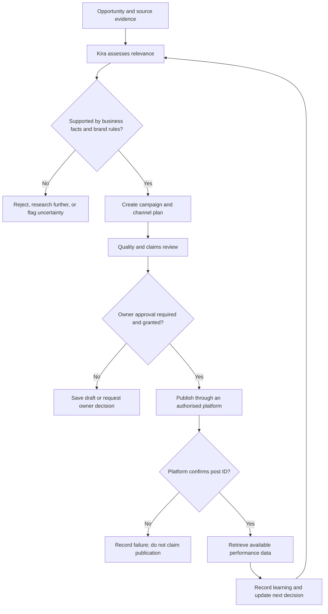
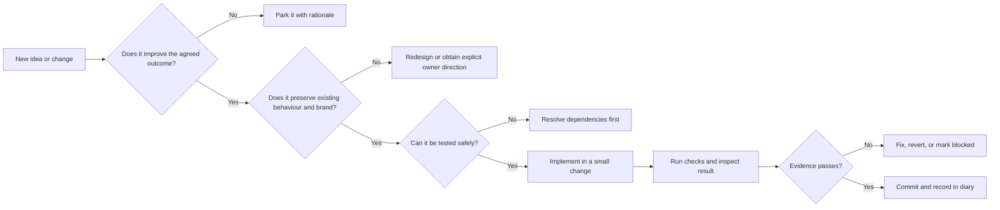

# Marketing Genius Command Centre — Build Diary

**Repository:** `lucasmaxxinfo-sketch/marketer`  
**Purpose:** A chronological, human-readable record of project decisions, implementation work, tests, failures, fixes and deployments.

This diary is the project narrative. Git commits remain the authoritative record of code changes; GitHub Actions and deployment checks remain the evidence for build and release outcomes. The diary links those records where possible and never labels unverified work as complete.

## How entries are recorded

Each entry should state:
- **Date and time:** Include the project timezone when known.
- **Objective:** What the work is intended to achieve.
- **Work performed:** What actually changed.
- **Evidence:** Commit, pull request, workflow run, test output or deployment URL.
- **Result:** Verified, partial, blocked or not yet tested.
- **Next action:** The next concrete step.

Record meaningful decisions and implementation milestones, not every trivial edit. Note regressions and their resolution rather than silently erasing them. Never put passwords, API keys, access tokens or other secrets in this diary.

---

## 2026-11-06 — Project management and baseline audit

**Objective:** Establish one continuous build record and identify the real state of the existing application before changing it.

**Work performed:**
- Confirmed the existing repository: [lucasmaxxinfo-sketch/marketer](https://github.com/lucasmaxxinfo-sketch/marketer).
- Inspected the existing frontend, cinematic styling, Kira character and voice files, PWA files, backend Worker and deployment workflow definitions.
- Confirmed the established cosmic/Kira creative direction must be preserved. A replacement generic dashboard is explicitly out of scope.
- Created [docs/BUILD-STATUS.md](./BUILD-STATUS.md), documenting the repository inventory, conditional capabilities, known implementation gaps and staged delivery sequence.
- Committed the audit as [e542164](https://github.com/lucasmaxxinfo-sketch/marketer/commit/e54216435ae7e019e1cb17638bf0aa4de13fd5e5).

**Findings from source inspection:**
- The frontend contains campaign, review, planning, business setup and local draft workflows.
- The Worker defines owner authentication, campaign storage endpoints, AI chat/strategy/generation, Facebook and Instagram publishing, and limited Facebook insights.
- Several live capabilities depend on Cloudflare Worker configuration and secrets. The tracked Wrangler configuration contains a KV namespace placeholder; the deployment workflow may inject configuration at runtime, which cannot be confirmed from source inspection alone.
- The Worker publishing code requires explicit owner approval. Its supported publishing paths are currently Facebook Page feed posts and Instagram feed image posts.
- Timed autonomous publishing, TikTok publishing, Google Business Profile publishing and broad cross-platform analytics are not established by the inspected Worker code.

**Result:** Baseline source audit recorded and committed. This is not a live deployment or end-to-end functionality test. Production service health, credentials, connected accounts and actual publishing remain unverified.

**Next action:** Verify the deployed Pages site and Worker health endpoint, then test secure owner login, AI generation, cloud persistence and publishing in a controlled environment. Record actual workflow results and evidence here.

---

## 2026-11-06 — Visual architecture and decision governance added

**Objective:** Make the build diary useful as a project-management instrument, not just a list of dated notes.

**Work performed:**
- Added a vector system architecture map at [docs/assets/marketing-genius-system-map.svg](./assets/marketing-genius-system-map.svg).
- Added a campaign decision flow showing evidence checks, brand fit, owner approval, provider confirmation and learning.
- Added a decision register covering repository continuity, creative direction, publishing authority, confirmation requirements and scheduling safety.
- Added a change-quality gate and evidence rules for future charts and performance reporting.

**Evidence:**
- Architecture image commit: [2fd7d5a](https://github.com/lucasmaxxinfo-sketch/marketer/commit/2fd7d5aeea1e45502b45743d5d250965f4728685).
- Diary and decision-governance commit: [bf6f5b7](https://github.com/lucasmaxxinfo-sketch/marketer/commit/bf6f5b7aa2a829b6802a5ff9c582ef188e47d220).

**Result:** Documentation changes committed. Diagram and decision flow are source-backed architecture explanations; they do not claim all services are deployed or operational.

**Next action:** Verify the live frontend and Worker deployment, then exercise the real authentication, storage, AI and publishing paths. Only after collecting actual metrics should the diary include performance charts.

---
## 2026-11-06 — Kira-centred product identity reaffirmed

**Context:** The owner clarified that the Command Centre must be unmistakably its own product. Its uniqueness comes from Kira being the central operating intelligence, not from adding a fashionable visual skin to a conventional marketing dashboard.

**Decision:** Build an agent-led marketing environment. Kira is the organising centre of the product: the interface, workflows, status, decisions and feedback loops should express what Kira is doing, what she has learned, what needs her attention and where owner direction is required. The workspace supports Kira's operation; Kira does not merely sit inside a generic dashboard.

**Experience principles:**
- Preserve the established cosmic environment, character identity and visual language already in the repository.
- Make motion meaningful: it should communicate presence, state changes, transitions, progress and attention, not act as constant decoration.
- Treat sound and music as part of the experience design, with explicit user controls, sensible defaults and no surprise autoplay.
- Keep the experience legible and usable: provide mute/volume controls, reduced-motion support, keyboard access, responsive behaviour and clear non-audio state cues.
- Let the interface reflect the actual operating state. Never use animation to imply that Kira is working, connected or publishing when the underlying service has not confirmed it.
- Keep owner authority visible for decisions and externally consequential actions.
- Reject generic dashboard patterns or visual effects that do not strengthen Kira's identity or make the operation clearer.

**Rationale:** Product distinction must come from the operating model and coherent experience, not surface decoration alone.

**Acceptance checks:**
1. A first-time user can tell that Kira is the active marketing operator and understand what she is currently doing.
2. Each major screen supports a real task or decision in Kira's workflow.
3. Motion communicates a meaningful state and respects reduced-motion settings.
4. Sound is intentional, user-controlled and never required to understand status.
5. Live activity indicators are backed by real application state.
6. The interface remains clear on phone and desktop.

**Status:** Product direction accepted and recorded. Runtime implementation and visual QA against the deployed app remain to be completed.

**Next action:** Inspect the existing animation, voice, audio and state-management code, then implement the highest-value experience improvements without replacing the established design.

---
## 2026-11-06 — Executive experience standard defined

**Owner direction:** The finished product must meet an executive standard: solve the job clearly, be effortless to use, polished, simple, elegant and premium, while retaining a playful, exciting and distinctive character.

**Design decision:** The experience must balance premium restraint with personality. It should feel expensive through precision, consistency, typography, spacing, transitions, sound design and responsive behaviour, not through visual clutter or ornamental effects.

**Experience requirements:**
- **Clarity first:** A user should understand the current state, the next useful action and any decision requiring attention without learning the underlying machinery.
- **Simple operation:** Reduce navigation friction, expose complexity progressively and make common actions obvious.
- **Premium craft:** Consistent layout, deliberate typography, disciplined colour, carefully composed motion and polished responsive states.
- **Distinctive personality:** Preserve Kira as the centre of the operating model and retain the established cosmic visual identity; do not flatten the product into a generic enterprise dashboard.
- **Playful, not childish:** Use character, motion and sound to create energy while keeping business tasks clear and credible.
- **Accessible control:** Sound must be optional and controllable; motion must respect reduced-motion preferences; essential information must never depend on audio or animation alone.
- **Trustworthy status:** Show real operating state and confirmed outcomes. Do not simulate activity, performance or integrations.

**Acceptance criteria:**
1. First-use comprehension: a new user can identify Kira, the workspace purpose and the next action quickly.
2. Task completion: core workflows can be completed without unnecessary steps or ambiguous controls.
3. Visual consistency: screens, dialogs, controls, loading, empty, success and error states share one coherent design system.
4. Premium restraint: every animation, sound and visual element has a functional or experiential purpose.
5. Responsive quality: layouts remain legible and usable on phone and desktop.
6. Accessibility: keyboard, contrast, reduced-motion and sound controls are included in QA.
7. Operational honesty: interface indicators reflect verified backend state.

**Status:** Direction recorded as an acceptance standard. Existing UI has not yet been re-audited against every criterion; implementation and QA remain outstanding.

**Next action:** Audit the current UI components and styles against this standard, identify the highest-impact usability and polish gaps, then implement and verify changes incrementally.

---
## Project map

The map shows the intended operating relationships. It is an architecture model, not evidence that every integration is live.

## Decision register

| ID | Decision | Reason | Consequence | Status |
|---|---|---|---|---|
| ADR-001 | Continue in the existing `lucasmaxxinfo-sketch/marketer` repository | Preserve established work and avoid competing builds | All changes are incremental and committed to this repository | Accepted |
| ADR-002 | Preserve the cosmic environment and Kira-centred creative direction | This is the established product identity in the source | No generic dashboard replacement | Accepted |
| ADR-003 | Owner approval remains mandatory for public publishing | Publishing is externally consequential and brand-sensitive | Drafting may be autonomous; public posting is gated | Accepted |
| ADR-004 | Never infer successful publishing from an attempted API call | Platform confirmation is the evidence of publication | Require a returned provider post ID before marking published | Accepted in current Worker |
| ADR-005 | Do not treat date-only planning as a publishing schedule | A date without a safe posting time and timezone is insufficient | Automated timed publishing remains out of scope until queue semantics are implemented | Accepted |
| ADR-006 | Keep source-code presence separate from live-service verification | Secrets, account permissions and deployment state are not visible in repository source | Every capability receives a tested status and evidence link | Accepted |

## Decision quality gate

## Current delivery view

| Workstream | Evidence-based state | Next decision or action |
|---|---|---|
| Existing frontend and Kira presentation | Source files present | Browser/device QA against the deployed experience |
| Campaign drafts and review | Implemented in frontend source | Exercise end-to-end with a real campaign record |
| Cloud API and owner login | Worker source and deployment workflow present; live state unverified | Verify deployment, health and authentication |
| AI campaign generation | Worker route present; requires server configuration | Verify configured provider and run a controlled generation test |
| Facebook and Instagram publishing | Worker paths present; require Meta credentials and permissions | Verify account setup, approval gate and provider confirmation |
| Timed autonomous publishing | Not implemented as a live scheduler; cron list is empty | Design queue, timezone, posting time, retries and idempotency before enabling |
| TikTok and Google Business publishing | Not implemented in inspected Worker | Assess platform APIs and permissions before implementation |
| Analytics | Limited Facebook insights route present | Test provider response and define metric coverage |

## Visual evidence and metrics policy

- Use architecture diagrams to explain relationships, not to imply deployment status.
- Use charts only when there are actual measured values and a stated source, date range and unit.
- Keep targets, forecasts, manually entered results and platform-retrieved metrics visually distinct.
- Every decision entry must link to evidence where possible: commit, test run, issue, deployment or provider response.
- Never create illustrative values that could be mistaken for business performance.

## Standard decision record

Each significant decision should use this structure:

1. **Context:** What problem or opportunity prompted the decision?
2. **Options considered:** What realistic alternatives were evaluated?
3. **Decision:** What was selected?
4. **Rationale:** Why is it the strongest option?
5. **Risks and trade-offs:** What could go wrong or be deferred?
6. **Verification:** What evidence will prove the decision worked?
7. **Review trigger:** What new evidence would justify changing it?

---

## Ongoing project log

New entries are appended below in reverse chronological order. Each entry must distinguish source-code presence from successful live operation.
## 2026-11-06 — Privacy and data protection established as cross-cutting requirements

**Owner direction:** Privacy must be considered throughout the entire product, not treated as a standalone legal page or a final release checklist.

**Decision:** Apply privacy-by-design and data-protection-by-default to every relevant feature, workflow, integration, screen and operational process across Marketing Genius and Kira.

**Cross-cutting requirements:**
- Collect only information needed for a clearly defined purpose; document why each category is needed.
- Make data flows understandable and traceable, including what Kira observes, infers, stores, sends to providers and uses to make decisions.
- Keep credentials, access tokens and secrets server-side; use least-privilege permissions and secure OAuth flows where supported.
- Separate business data, customer personal information, analytics, operational logs and credentials with appropriate access controls and retention rules.
- Define retention, deletion, export, correction and account-disconnection behaviour before the relevant feature is released.
- Disclose relevant third-party processing and integrations; do not imply that a provider or legal policy covers processing unless verified.
- Give the owner meaningful control over connected accounts, data sources, publishing permissions, automation scope and pause/revocation.
- Avoid collecting sensitive or unnecessary personal information. Require a documented lawful purpose and appropriate safeguards for any higher-risk processing.
- Protect data in transit and at rest where supported; assess backups, logs, error reporting and generated campaign assets for accidental exposure.
- Build privacy notices and consent/permission prompts into the point where they are relevant, without cluttering Kira's normal working environment.
- Record security-relevant actions and externally consequential decisions in an appropriately protected audit trail.
- Test privacy and security failure cases, including revoked tokens, unauthorised access, deletion, provider outages and accidental data disclosure.

**Governance:** The product is currently being developed under the owner's present build arrangement. Do not assume Torrellium/Trillium legal entities, universal policies or contractual coverage are established. Confirm the responsible legal entity, jurisdiction-specific obligations, provider terms and final legal wording before public release.

**Acceptance rule:** A feature is not complete merely because its happy path works. Its data purpose, access, storage, sharing, retention, deletion, user/owner controls and failure behaviour must also be considered and documented.

**Status:** Cross-cutting design and engineering requirement recorded. This entry does not certify legal compliance or prove all controls are implemented.

**Next action:** Include a privacy/security review in each feature's definition of done and maintain a product-wide data-flow and control register.

---

## 2026-11-06 — Kira portrait initialisation regression identified and corrected

**Objective:** Restore the main application render path and Kira's 3D portrait initialisation.

**Evidence found:** The existing browser-check workflow (run 73, 5 November 2026) failed on both mobile (390px) and desktop (1365px). Its logs showed the runtime exception `$(...).forEach is not a function`. The failure occurred in the main render routine: the single-element helper `$` (based on `querySelector`) was incorrectly used as though it returned a collection when activating navigation items. This stopped rendering before the dashboard and Kira dimension/portrait initialisation could complete.

**Work performed:** Replaced the incorrect selector helper with the existing collection helper `$$` for the navigation-item iteration. No visual redesign or replacement of the existing Kira experience was made.

**Evidence:** Fix committed as [7262689](https://github.com/lucasmaxxinfo-sketch/marketer/commit/7262689f2d18262a75dce15a77df5e923140beb0). GitHub Pages deployment workflow run [213](https://github.com/lucasmaxxinfo-sketch/marketer/actions/runs/42185571134) was queued at the time of this entry.

**Result:** Source-level correction committed. The fix is not yet marked browser-verified; the mobile/desktop Kira portrait workflow must pass after the change.

**Next action:** Confirm the deployment and rerun/observe the browser checks. If the portrait still fails, capture the full browser error stack and continue debugging rather than masking the failure.

## 2026-11-06 — Kira navigation and portrait recovery verified

**Correction to the earlier portrait-regression entry:** The previous record cited commit `7262689` as the selector fix, but the subsequent browser run still found the stale selector on the main branch. The actual correction to the render routine is commit [`d8a9fa7`](https://github.com/lucasmaxxinfo-sketch/marketer/commit/d8a9fa792f39d95459a2e01a8162a7afdd258439), which replaces the single-element lookup with the existing collection helper for navigation iteration.

**Additional root causes found:**
- The original Kira check expected a 3D canvas inside the portrait element. The current product uses the supplied portrait image for Kira and a separate Three.js canvas for the surrounding dimension. The test was updated to verify the real implementation instead of an obsolete structure.
- The workspace sidebar was hidden with `display:none` even after the owner opened the menu. Commit [`0f2cd88`](https://github.com/lucasmaxxinfo-sketch/marketer/commit/0f2cd88a217e07c5a9f3c4ec38c2e62e254d4cd9) makes the sidebar visible only while its open state is active.
- A legacy mobile rule in `styles.css` applied `bottom:128px` to a relatively positioned portrait. This moved Kira upward and clipped her head. Commit [`93ac75d`](https://github.com/lucasmaxxinfo-sketch/marketer/commit/93ac75d1c05a3d3779584c3d538c012066c27495) explicitly resets the inherited top/right/bottom/left offsets in the final mobile layout.

**Verification evidence:**
- Kira portrait workflow [run 42189297265](https://github.com/lucasmaxxinfo-sketch/marketer/actions/runs/42189297265): passed on commit `93ac75d`.
- Mobile portrait geometry: 390 × 844 viewport; portrait bounds top 63px, bottom 350px. The complete image is visible.
- Desktop portrait geometry: 1365 × 900 viewport; portrait bounds top 190px, bottom 574px. The complete image is visible.
- Both viewports confirmed the image loaded, the Three.js scene canvas initialised, all five portals rendered, no horizontal overflow and no page errors.
- General browser workflow [run 42188816680](https://github.com/lucasmaxxinfo-sketch/marketer/actions/runs/42188816680): passed on mobile and desktop, including workspace navigation, sound toggle, reduced-motion and keyboard checks.
- GitHub Pages deployment [run 42189297262](https://github.com/lucasmaxxinfo-sketch/marketer/actions/runs/42189297262): succeeded on commit `93ac75d`.

**Outcome:** Kira's main portrait is now browser-verified on mobile and desktop, and the menu visibility defect is corrected. The existing visual identity and portrait asset were preserved.

**Still in progress at this entry:** A final general browser run and a fresh Android APK build for the latest commit. Backend Worker health, live AI configuration, Meta permissions and real publishing remain separate release gates and are not inferred from frontend tests.

## 2026-11-06 — Android test package generated

**Result:** The Android build workflow completed successfully on commit `93ac75d`. It generated an installable debug-signed APK and published it as GitHub release [`android-build-126`](https://github.com/lucasmaxxinfo-sketch/marketer/releases/tag/android-build-126).

**Build evidence:** [Android workflow run 42189297349](https://github.com/lucasmaxxinfo-sketch/marketer/actions/runs/42189297349).

**Distribution note:** This is a debug-signed test build, not a Play Store production release. Install only on a device you control. A real-device installation and usability check remains outstanding.

## 2026-11-06 — Live API deployment gate confirmed

**Evidence:** The latest inspected API deployment workflow [run 41984097080](https://github.com/lucasmaxxinfo-sketch/marketer/actions/runs/41984097080) passed backend JavaScript syntax validation but stopped at the required-settings check before contacting Cloudflare.

**Missing repository secrets:** `CLOUDFLARE_API_TOKEN`, `CLOUDFLARE_ACCOUNT_ID`, `MG_DATA_KV_ID`, `APP_LOGIN_PASSWORD`, `SESSION_SECRET` and `OPENAI_API_KEY`.

**Decision:** Do not bypass the gate, commit credentials, or represent the Worker as deployed. The repository owner must configure the six private values in GitHub Actions secrets. Meta publishing credentials are additional and remain unverified.

**Consequence:** The frontend and Android test package can be delivered independently, but live AI conversation, cloud persistence and real publishing cannot be treated as operational until the Worker deployment and provider checks succeed. No timed autonomous publishing is enabled.

## 2026-11-06 — Owner privacy and campaign data controls

**Objective:** Close the gap between device-local data and cloud campaign storage, and make data processing visible to the owner.

**Implemented:**
- Settings now explains which workspace information is stored in the browser and what is sent to the configured Worker/OpenAI when AI features are used.
- Export now bundles the local workspace and, when an authenticated cloud session is active, all cloud campaign records.
- Added an owner-authenticated bulk-delete endpoint for cloud campaign records. It paginates KV listings and deletes in batches; non-campaign KV keys are not included.
- Added a separate delete-cloud-campaigns action that clears the cloud campaign records and local campaign copies while retaining the local business profile and other settings.
- Renamed local clearing to **Clear device data**, clarified that it does not delete cloud records, and clear the current tab's access token as part of that action.
- Added **Sign out on this device**, which removes the current tab's access token. The signed token itself expires after 12 hours.
- Incremented the service-worker cache version so clients fetch the new privacy controls.
- Added backend automated tests for owner-only deletion, KV pagination beyond 1,000 campaigns, and preservation of non-campaign KV records.

**Evidence:**
- Worker bulk-delete endpoint: commit `6cd1771`.
- Privacy/export/sign-out UI: commits `055aecb` and `b974aff`.
- Backend test suite and workflow integration: commits `e6fef19`, `51aadbe`, `1d79301`, `f815ab6`.
- Privacy panel styling: `021a03b`.
- Service-worker cache refresh: `ae46151`.
- Backend syntax check and all three automated data-control tests passed in [API workflow run 42192100218](https://github.com/lucasmaxxinfo-sketch/marketer/actions/runs/42192100218).

**Security boundary:** Cloud deletion and cloud export require an authenticated Worker session. Local clearing does not delete cloud data. The app does not currently provide deletion/disconnection for third-party Meta account data, and this work is not a legal compliance certification.

**Pending verification:** Browser checks and the latest Pages deployment for the new settings UI. The API deployment itself remains blocked by the six missing Cloudflare/OpenAI repository secrets previously recorded.

## 2026-11-06 — AI context minimisation and business identity correction

**Objective:** Ensure Kira receives only the information needed for a task and does not assume a fixed list of owner businesses.

**Work performed:**
- Added a shared frontend inventory-context builder. AI requests now include at most 30 products, with bounded field lengths for product name, price, stock and category.
- Added server-side sanitisation for inventory context in both chat and campaign generation. The Worker independently applies the limits even if a client sends an oversized or unexpected structure.
- Campaign-generation requests now use a bounded brief: business name, offer, audience, goal, angle, brand voice, platform list and a limited business description. Unneeded raw channel-setup notes are not forwarded.
- Removed stale hard-coded business identities from Kira's chat system prompt. Kira now uses the business or businesses supplied in the owner's current context rather than assuming a preset list.

**Evidence:**
- Frontend AI payload minimisation: commit `5808dfe`.
- Worker sanitisation and identity correction: commit `c7db11c`.
- Corrected declaration order discovered by the test suite: commit `3d525fb`.
- Four backend tests passed, including a test that confirms the AI provider receives no more than 30 bounded product records and no hard-coded business identity: [API workflow run 42192622926](https://github.com/lucasmaxxinfo-sketch/marketer/actions/runs/42192622926).

**Result:** Data minimisation is now enforced on both sides of the API boundary. Worker deployment remains blocked by the missing private secrets; the code and automated tests are ready, but the live service has not been updated.

## 2026-11-06 — Privacy UI browser verification and Android package refreshed

**Frontend verification:**
- Privacy settings and local export were exercised in Chromium on mobile and desktop. The test checked the privacy disclosure, export control, local-clear control, and absence of cloud-delete controls when no cloud session exists.
- [Browser workflow run 42192290276](https://github.com/lucasmaxxinfo-sketch/marketer/actions/runs/42192290276) passed.
- The broader mobile/desktop browser suite on the updated frontend also passed in [run 42192476417](https://github.com/lucasmaxxinfo-sketch/marketer/actions/runs/42192476417).

**Android package:**
- Rebuilt the APK with the privacy panel, local/cloud data controls and bounded frontend AI inventory context.
- [Android workflow run 42192476392](https://github.com/lucasmaxxinfo-sketch/marketer/actions/runs/42192476392) passed.
- New debug test package: [release android-build-131](https://github.com/lucasmaxxinfo-sketch/marketer/releases/tag/android-build-131). This remains a debug-signed test build, not a Play Store release.

**Deployment:** The Pages deployment containing the privacy UI and bounded frontend context succeeded in [run 42192702015](https://github.com/lucasmaxxinfo-sketch/marketer/actions/runs/42192702015). A subsequent documentation-only deployment is running.

**Remaining boundary:** Worker code has passed all four automated tests, but the Worker deployment still cannot proceed until the six required private secrets are configured.

## 2026-11-06 backend security test expansion

Added four additional automated Worker tests covering:
- Expired owner sessions are rejected.
- Requests from unapproved browser origins are rejected.
- Publishing is blocked unless both the campaign and post carry explicit owner approval.
- An approved post remains unpublished when Meta provider credentials are absent.

The API workflow executed all eight Worker tests successfully (8 passed, 0 failed). The workflow then stopped at its deployment-settings gate because all six required private GitHub Actions secrets were absent. It did not contact Cloudflare, and no live backend deployment is claimed.

Evidence: [API workflow run 42196394879](https://github.com/lucasmaxxinfo-sketch/marketer/actions/runs/42196394879).

## 2026-11-06 upstream reliability hardening

All outbound OpenAI and Meta API requests now use a 20-second timeout. Network failures and timeouts are reported as upstream gateway errors rather than being misclassified as malformed owner requests. Publishing remains unconfirmed and the saved post remains approved when Meta cannot be reached. Facebook insights now send the access token in the Authorization header rather than embedding it in the request URL.

Two additional automated tests verify Kira chat's provider-outage response and confirm that a Meta outage cannot mark an approved post as published. The API workflow reports 10 tests passed and 0 failed before reaching the deployment-secret gate.

Evidence: [API workflow run 42197279525](https://github.com/lucasmaxxinfo-sketch/marketer/actions/runs/42197279525). The Worker was not deployed because required private GitHub Actions secrets remain absent.

## 2026-11-06 — Persistent Kira operations queue added

**Objective:** Establish the durable work model Kira needs before building autonomous research and opportunity workflows.

**Work performed:**
- Added owner-authenticated `GET`, `POST` and `PATCH` operations endpoints to the existing Worker.
- Stored operations under a separate `operation:` KV prefix, keeping campaign records and login-rate-limit records separate.
- Added supported operation types for research, opportunity assessment, campaign preparation, quality review, owner decisions and publishing.
- Added explicit state transitions: queued, in progress, awaiting owner, blocked, completed and cancelled.
- Added bounded source/evidence metadata and a 30-entry status history per operation.
- Added a backend test for record creation, valid state advancement, audit history, invalid transition rejection and listing.
- Updated the build status to distinguish this queue foundation from a live autonomous agent.

**Evidence:** Worker commit [a65cd2a](https://github.com/lucasmaxxinfo-sketch/marketer/commit/a65cd2a382df5b0674d01634330f724ec26f6c68); test commit [e597eea](https://github.com/lucasmaxxinfo-sketch/marketer/commit/e597eeaa242ab7876dfe13efaed6376be6b7ccb1).

**Result:** Source changes committed. Automated workflow and live Worker deployment have not yet been verified. No claim is made that Kira is autonomously researching or scheduling work.

**Next action:** Verify CI, then connect this persistent queue to evidence-backed research and the existing Kira interface without simulating activity.

## 2026-11-06 — Kira’s work view connected to campaign preparation

**Objective:** Make the new operations model visible in the product and connect it to work Kira already performs, rather than creating an unused backend subsystem.

**Work performed:**
- Added **Kira’s work** to the main navigation and view registry.
- Added a compact operations list showing real operation state, priority, type, last update, result and blocker.
- Added a refresh action for the authenticated cloud queue; local-only mode is clearly labelled.
- Connected the existing **Let Kira work** action to an operation lifecycle: queued, in progress, then awaiting owner after a campaign draft is saved.
- Preserved the current campaign generation and owner approval flow.

**Evidence:**
- Frontend integration commit: [e7c7574](https://github.com/lucasmaxxinfo-sketch/marketer/commit/e7c75740a84573658ed0ec3a75f16121a5eda075).
- Navigation commit: [1cc15c6](https://github.com/lucasmaxxinfo-sketch/marketer/commit/1cc15c651e2a774ff7c0e90caa11151b1884fd96).
- Syntax correction: [60a7853](https://github.com/lucasmaxxinfo-sketch/marketer/commit/60a7853f115c450ba4cccbe1bae7de01c0a72375).
- Mobile and desktop browser verification: [run 42198737046](https://github.com/lucasmaxxinfo-sketch/marketer/actions/runs/42198737046).
- GitHub Pages deployment: [run 42198737100](https://github.com/lucasmaxxinfo-sketch/marketer/actions/runs/42198737100).

**Result:** Frontend syntax, browser regression checks and Pages deployment passed. The first integration attempt exposed a duplicate `async` declaration; this was corrected and the subsequent syntax and browser checks passed. The Worker remains blocked at its deployment-settings gate because private secrets are absent. The queue is not yet cloud-live.

**Next action:** Add dedicated queue UI tests, verify the Android build, then implement evidence-backed research and opportunity assessment as actual Kira operations. Do not introduce scheduled autonomous scans until source provenance, freshness, usage limits and pause controls are in place.

## 2026-11-06 — Kira live research, source evidence and data controls

**Objective:** Give Kira a real route to current marketing evidence, attach that evidence to recorded work, and make the resulting records visible and controllable by the owner.

**Research backend:**
- Added owner-authenticated `POST /api/research` using the OpenAI Responses API and hosted `web_search` tool. Search is required on every request.
- Added bounded context for business, business description, location/service area, audience, selected channels and inventory.
- Prompted Kira to prioritise recent credible evidence, local relevance, commercial fit and explicit uncertainty. It must not manufacture trends, competitors, statistics, stock or offers; weak evidence should produce a no-campaign recommendation.
- Extracted cited source metadata from output annotations and web-search source results. A report without text or source references is rejected.
- Added server-side evidence sanitisation and persistence on operation updates.

**Product integration:**
- Added the **Research opportunities** action to Kira’s work view. It records the operation, marks it in progress, calls live research, then moves it to awaiting owner with the research report and sources attached.
- Added a business location/service-area setting and included it in the research brief.
- Added a live-research capability indicator to the API health response.
- Added readable report and source links to operation cards.

**Privacy and reliability:**
- Workspace export now includes cloud operation records as well as campaign records.
- Added owner-only bulk deletion of operation records, paginated across the KV namespace and isolated from campaign/login keys.
- Added a separate Settings control to delete cloud operations and local operation copies.
- Expanded the privacy disclosure to explain that live research sends bounded business context to OpenAI and stores research reports/source links in the operations queue.
- Updated the PWA cache to `mgcc-cache-v31`.
- Expanded mobile/desktop browser checks for the research action, the location field, privacy disclosure and cloud-operation deletion visibility.

**Evidence and commits:**
- Research endpoint: [4c7c579](https://github.com/lucasmaxxinfo-sketch/marketer/commit/4c7c5790b40091f4152fe1d4da4038fbc35bfa18).
- Research tests: [87577dd](https://github.com/lucasmaxxinfo-sketch/marketer/commit/87577dd259c9522e77b87710bd91ef5a7e4c495e).
- Kira UI integration: [447764d](https://github.com/lucasmaxxinfo-sketch/marketer/commit/447764dbf54d7aeac04cd6b32ffa7ef9ea025df0).
- Operation evidence validation: [6eeabb2](https://github.com/lucasmaxxinfo-sketch/marketer/commit/6eeabb297e3002ffa0a3edb4f2aa16849665ad81).
- Operation deletion endpoint: [4694510](https://github.com/lucasmaxxinfo-sketch/marketer/commit/46945103a589e06190c3671c1de1ac40e9780074).
- Operation deletion test: [bb7841c](https://github.com/lucasmaxxinfo-sketch/marketer/commit/bb7841c19567848e34a2a7598578ba9610fdf171).
- Privacy/export UI: [7850532](https://github.com/lucasmaxxinfo-sketch/marketer/commit/7850532a8d41c46ecad5da2e23a304429d15633c).
- Latest browser assertions: [3aaa592](https://github.com/lucasmaxxinfo-sketch/marketer/commit/3aaa5923a110c07213d29ab0b995c039546ab9d5).
- Latest cache update: [0a6ac31](https://github.com/lucasmaxxinfo-sketch/marketer/commit/0a6ac31bc47fa81cdff92ee4efc8df0276b29c98).
- Backend workflow [42199655845](https://github.com/lucasmaxxinfo-sketch/marketer/actions/runs/42199655845): 14 passed, 0 failed. It failed only at the required-secret gate before Cloudflare deployment.

**Current boundary:** The code and mocked automated integration tests are passing. No live OpenAI web-search call has been made through the deployed Worker because the Worker is still not deployed. No autonomous recurring scans are enabled.

**Next:** Complete the latest browser and PWA checks, then build the opportunity-to-campaign handoff so the owner can turn a selected evidence-backed opportunity into a campaign draft without re-entering the context. Keep scheduled scanning out until the Worker is deployed and source freshness, usage limits, pause controls and operational alerting are verified.

## 2026-11-06 — Evidence-backed opportunity can now become a campaign

**Objective:** Close the loop between research and finished marketing work. Kira should not leave a useful opportunity sitting in a report; the owner should be able to select it and have Kira prepare the campaign.

**Work performed:**
- Added **Build campaign from this** to awaiting-owner opportunity records.
- The action requires an authenticated live workspace.
- Creates a distinct campaign-preparation operation, stores the selected research evidence and records the transition to in-progress.
- Passes the research report and source URLs into the existing campaign generator.
- Strengthened campaign-generation instructions so source-backed research is treated as internal evidence, not automatically repeated as customer-facing claims.
- Saves the generated campaign to cloud storage with its source operation ID and research evidence.
- Moves the preparation operation to awaiting owner, closes the selected research operation as completed, and returns the owner to **To review**.
- Publishing remains blocked by the existing explicit owner approval gate.

**Evidence:**
- Handoff UI/workflow: [75c157a](https://github.com/lucasmaxxinfo-sketch/marketer/commit/75c157a23e7dd4df768a727d3bdd1ca8ee650af4).
- Local operation-state reconciliation: [bfc0fa9](https://github.com/lucasmaxxinfo-sketch/marketer/commit/bfc0fa95839826d527208b8b78c07330d6969d6c).
- Campaign-generation research guard: [238e12d](https://github.com/lucasmaxxinfo-sketch/marketer/commit/238e12da3178ea6268447de5edc0a2329757653e).
- Service-worker cache refresh: [4cf8a46](https://github.com/lucasmaxxinfo-sketch/marketer/commit/4cf8a46acee7a122feb7ebbc1a518701910f4208).
- Browser handoff guard test: [2d885e0](https://github.com/lucasmaxxinfo-sketch/marketer/commit/2d885e0c27a7d0a93efb2a2c7384dba12cc60416).
- Mobile/desktop browser verification: [run 42200156118](https://github.com/lucasmaxxinfo-sketch/marketer/actions/runs/42200156118), passed.
- PWA deployment: [run 42200155983](https://github.com/lucasmaxxinfo-sketch/marketer/actions/runs/42200155983), succeeded.
- Backend tests: [run 42200047821](https://github.com/lucasmaxxinfo-sketch/marketer/actions/runs/42200047821), 14 passed, 0 failed before the deployment-secret gate.

**Outcome:** The deployed frontend now contains the research-to-campaign handoff and the PWA cache is v32. The Android rebuild for this cache is pending. The Worker still cannot deploy because its six private repository secrets are missing, so no live end-to-end research or generation has been claimed.

**Next:** Complete the Android rebuild, then unblock and deploy the Worker. After deployment, test a real owner login, live web research with returned citations, operation persistence, campaign generation from a selected opportunity and the final owner approval boundary. Only then begin designing scheduled research scans.

## 2026-11-06: Campaign research provenance and Android build 143

- Campaigns created from a researched opportunity already retain `researchEvidence` and `sourceOperationId`. The campaign review now displays the retained HTTPS source links, source labels and available research timestamps so the owner can inspect the evidence before approving copy.
- Evidence links are rendered only when their URL parses as HTTPS. Links open in a separate tab with `noopener noreferrer`; labels and timestamps are escaped for display.
- Service-worker cache advanced to `mgcc-cache-v33` so installed PWA clients fetch the updated review screen.
- Android workflow run [42200132420](https://github.com/lucasmaxxinfo-sketch/marketer/actions/runs/42200132420) completed successfully and published [Android build 143](https://github.com/lucasmaxxinfo-sketch/marketer/releases/tag/android-build-143). The uploaded `app-debug.apk` is 4,135,539 bytes and debug-signed for testing.
- Existing limitations remain: the Worker deployment is blocked by missing repository secrets. The APK does not make cloud AI or live research operational without a configured backend.

## 2026-11-06: Explicit campaign evidence browser regression test

- Extended `.github/workflows/visual-check.yml` with a seeded research-backed campaign in the browser fixture.
- The test opens the campaign review and asserts that the expected HTTPS source is displayed, while a `javascript:` URL is excluded from the rendered evidence links.
- Mobile (390px) and desktop (1365px) browser verification passed: [run 42203263017](https://github.com/lucasmaxxinfo-sketch/marketer/actions/runs/42203263017).
- PWA deployment for the test commit completed successfully: [run 42203262995](https://github.com/lucasmaxxinfo-sketch/marketer/actions/runs/42203262995).
- Current Android testing package is [build 145](https://github.com/lucasmaxxinfo-sketch/marketer/releases/tag/android-build-145), debug-signed and based on the same app and cache-v33 implementation. The latest workflow-only test change does not alter app runtime code.

## 2026-11-06 — Navigation and mobile workspace UX refinement

**Objective:** Make navigation easier to understand and operate without disturbing Kira’s established home-stage design or the existing workspace workflows.

**Changes:**
- Added a clear active-page state to navigation and expose the current destination with `aria-current="page"`.
- Added a dismissible backdrop behind the existing navigation drawer. Tapping outside the drawer closes it.
- Escape now closes the navigation drawer as well as the existing campaign dialog.
- Kept the existing navigation model and all destinations. The initial attempt to add a persistent mobile bottom bar was removed after browser checks showed it competed with page actions and Kira’s home composition.
- Advanced the PWA cache to `mgcc-cache-v35`.

**Verification:**
- Mobile (390 × 844) and desktop (1365 × 900) browser verification passed, including the navigation drawer and outside-tap close: [run 42205774474](https://github.com/lucasmaxxinfo-sketch/marketer/actions/runs/42205774474).
- GitHub Pages deployment succeeded for the verified commit: [run 42205774518](https://github.com/lucasmaxxinfo-sketch/marketer/actions/runs/42205774518).
- Android build [152](https://github.com/lucasmaxxinfo-sketch/marketer/releases/tag/android-build-152) completed successfully in [run 42205700715](https://github.com/lucasmaxxinfo-sketch/marketer/actions/runs/42205700715). The release contains a debug-signed testing APK.

**Outcome:** The navigation refinement is deployed to the web app. No campaign, research, publishing or backend capability was changed.

## 2026-11-07 — Campaign review UX

**Objective:** Make Kira's campaign review easier to understand, edit and approve, while keeping owner control and the existing campaign workflow.

**Changes:**
- Reworked the review screen into a clear sequence: campaign decision/status, audience and goal summary, Kira's reasoning and research evidence, individual post content, then optional targets and actions.
- Each post now has a distinct heading, platform/context, readable editable copy, planned date and status controls.
- Review lookup now uses the campaign ID rather than its display name, so campaigns with duplicate names cannot open the wrong review.
- Copy and planning edits save to the device as they are changed. The explicit Save changes action also synchronizes the campaign to the cloud when an owner session is active.
- Saving now checks that every post marked Scheduled has a planned date.
- Clarified that saving or approving does not publish anything.
- Advanced PWA cache to `mgcc-cache-v36`.

**Verification:**
- Browser regression passed on mobile (390 × 844) and desktop (1365 × 900), including editing a post and asserting that the changed copy is persisted in local storage: [run 42321383137](https://github.com/lucasmaxxinfo-sketch/marketer/actions/runs/42321383137).
- GitHub Pages deployment succeeded for the tested commit: [run 42321383134](https://github.com/lucasmaxxinfo-sketch/marketer/actions/runs/42321383134).
- Android rebuild [run 42321354932](https://github.com/lucasmaxxinfo-sketch/marketer/actions/runs/42321354932) is still running; no new APK release is claimed yet.

**Outcome:** The campaign review refinement is deployed to the web app. The workflow remains approval-first and publishing remains a separate owner action.

### Owner decision queue: review before decision
- Simplified the To review queue so pending and returned campaigns expose one primary action: Review campaign.
- Removed immediate approve/send-back actions from those queue cards. Both owner decisions now appear inside the detailed campaign review, after the owner can inspect strategy, research provenance and individual post content.
- Retained the existing send-back reason prompt and approval confirmation. Neither action publishes content.
- Added mobile and desktop browser regression assertions for the review gate and both in-review decisions.
- Updated the service-worker cache to `mgcc-cache-v37`.
- Android build 154 completed successfully and includes the previous campaign review layout. The current queue refinement was committed after that build, so a fresh Android build is still required to include this latest change.

### Decision queue clarity refinement
- Added live counts to All, Pending and Sent back filters so the owner can see the size of each decision bucket before opening it.
- Added accessible `aria-pressed` state and a labelled filter group.
- Replaced the generic empty state with a message that reflects the selected filter.
- Updated the queue instruction to make the review-first process explicit.
- Added mobile and desktop regression checks for counts, filter state and filter-specific empty copy.
- Updated service-worker cache to `mgcc-cache-v38`.

### Kira work queue: truthful status and owner handoff
- Reworked operation cards to distinguish queued, in-progress, awaiting-owner, blocked, completed and cancelled states.
- Added plain-language explanations for each state, plus the latest recorded update when available.
- Blocked work now has a dedicated dependency panel that displays the recorded blocker, with a clear fallback if no reason was supplied.
- Completed work labels its result as a completed result. Research evidence remains visible as source links.
- The campaign-development handoff is shown only for an opportunity assessment that is awaiting an owner decision and has a saved result.
- Added mobile and desktop browser checks covering all five active test states, the blocker reason, completed result labelling and action eligibility.
- Updated the service-worker cache to `mgcc-cache-v39`.

### Kira operation audit trail and actor attribution
- Operation history now records whether a status transition was made by Kira or by the owner.
- Kira-created operations begin with Kira as the recorded actor; owner-created operations remain attributed to the owner.
- Kira's research, campaign preparation, blocked outcomes and completion transitions now identify Kira explicitly. Selecting a research opportunity is recorded as an owner action.
- Operation cards include a compact, expandable history showing recent status changes, actor, timestamp and note.
- Added Worker unit coverage for actor attribution and transition history, plus mobile and desktop browser checks for the visible history.
- Bumped the PWA service-worker cache to `mgcc-cache-v40`.

## 2026-11-07 — Kira research recovery

**Objective:** Make a blocked research task recoverable through the actual research workflow, rather than offering a status-only retry.

**Changes:**
- A blocked opportunity-assessment operation can now be retried from its existing work card when the owner is signed in.
- Retry reuses the same operation record, moves it through the allowed blocked → queued → in-progress transitions, and invokes the live research endpoint using the current business profile.
- A per-operation in-flight guard prevents repeated clicks in the same client from launching duplicate attempts.
- A successful transition out of the blocked state clears the stale blocker. A failed attempt records a fresh blocker and remains blocked.
- No generic retry is offered for publishing or campaign-preparation tasks that do not yet have a dedicated recovery handler.
- Approval and publication gates are unchanged.
- Advanced the PWA cache to `mgcc-cache-v41`.

**Verification pending:** Backend unit tests and mobile/desktop browser checks are triggered by the commits. The Worker still requires the six private deployment secrets before it can be deployed to Cloudflare.

## 2026-11-07 — Opt-in daily Kira opportunity monitoring

**Objective:** Move Kira beyond owner-started research by giving her a safe scheduled research cycle, without allowing unattended public actions.

**Implementation:**
- Added an authenticated cloud profile endpoint for the business context used by scheduled work. The Worker bounds business description, location, audience, platforms, voice and inventory fields before storage.
- Added a Settings control for daily opportunity monitoring. It is off by default because each live scan uses metered OpenAI web search.
- Added a daily Cloudflare Cron Trigger at 14:00 UTC. It reads the saved owner profile and exits without provider calls unless monitoring is enabled.
- Successful scans create a Kira-attributed opportunity assessment in **awaiting owner** with the report and HTTPS source evidence. Failed scans create a blocked operation with a reason.
- Added a per-day run marker to avoid normal duplicate scheduled scans. The daily scan never approves, publishes or purchases advertising.
- Connected the frontend settings save and initial cloud sign-in to the profile endpoint. Inventory changes sync to the cloud profile when connected.
- Updated PWA cache to mgcc-cache-v42.

**Verification status:** Worker tests were extended for bounded profile storage, successful scheduled research and the disabled-monitoring no-op. GitHub Actions verification and Pages deployment are pending. The scheduled feature is not live until the Worker deployment succeeds.

**Verification update:** Added a mobile/desktop browser assertion that the daily monitoring preference is off by default, can be enabled, and persists after saving. Browser verification passed in [run 42328709455](https://github.com/lucasmaxxinfo-sketch/marketer/actions/runs/42328709455). PWA deployment succeeded in [run 42328709528](https://github.com/lucasmaxxinfo-sketch/marketer/actions/runs/42328709528). The Worker syntax check and 19 automated tests pass; Cloudflare deployment remains blocked before the deployment action because required private settings are not visible to the workflow. Android rebuild is still in progress.

**Android verification:** Android build [170](https://github.com/lucasmaxxinfo-sketch/marketer/releases/tag/android-build-170) completed successfully and includes the daily monitoring preference UI. The APK is debug-signed for testing, not a production Play Store release.

## 2026-11-07 — Scheduled research source audit and open-source direction

**Objective:** Verify the actual current repository state after the owner clarified that the infrastructure and software must be free/open source wherever possible.

**Source findings:**
- The tracked Wrangler configuration contains a daily Cron Trigger at `0 14 * * *` (14:00 UTC, or 03:00 New Zealand daylight time).
- The Worker implements `runAutonomousResearch`. It requires configured KV and OpenAI services, a saved cloud business profile and the owner's explicit monitoring opt-in. It records source-backed opportunity work as `awaiting_owner`, or records failures as `blocked`.
- The scheduled feature has automated tests, but it has not been proven to run in production because the Worker has not deployed.
- The research engine currently calls OpenAI's hosted Responses API and hosted `web_search` service. This is a metered proprietary dependency and does not satisfy the new open-source-first direction.
- The latest API workflow [42328864384](https://github.com/lucasmaxxinfo-sketch/marketer/actions/runs/42328864384) passed JavaScript validation and all 19 Worker tests, then stopped at preflight because the runner received empty values for all six required private settings. It did not contact Cloudflare.
- The frontend deployment [42328939851](https://github.com/lucasmaxxinfo-sketch/marketer/actions/runs/42328939851), browser checks [42328709455](https://github.com/lucasmaxxinfo-sketch/marketer/actions/runs/42328709455), and Kira 3D checks [42328709532](https://github.com/lucasmaxxinfo-sketch/marketer/actions/runs/42328709532) succeeded.
- Android debug build 170 is available at [the GitHub release](https://github.com/lucasmaxxinfo-sketch/marketer/releases/tag/android-build-170).

**Correction:** Earlier status text said the Worker had no Cron Trigger configured. That statement was stale and incorrect. The Cron Trigger is configured in source, but live execution remains unverified. The Cron Trigger is for research only; it does not implement timed publishing.

**Decision:** Do not perform a destructive backend rewrite. Preserve the existing frontend and its working local-first behaviour. Document the current proprietary dependencies, define an open-source/self-hostable replacement architecture, and migrate one boundary at a time with compatibility tests. Do not claim that the current product is fully open source or has zero operating cost.

**Evidence:** [Updated build status](./BUILD-STATUS.md) and [Open-source roadmap](./OPEN-SOURCE-ROADMAP.md).

**Next action:** Complete the dependency and asset licence inventory, then prototype a self-hosted Node.js API with SQLite and a local model adapter. Keep the current Worker behind a compatibility boundary until the replacement passes the same authentication, campaign, operations, research and approval tests.

**Result:** Source audit and project records updated. No production backend deployment or migration is claimed.

## 2026-11-07 — First self-hosted backend runtime implemented

**Objective:** Begin removing the Cloudflare Workers/KV runtime dependency without rewriting or destabilising the existing API business logic.

**Implementation:**
- Added `backend/local/server.mjs`, a Node.js 24 HTTP adapter that calls the existing Worker `fetch` handler using standard Fetch API Request/Response objects.
- Added `SQLiteKV`, implementing the KV operations the Worker currently consumes: `get` (string and JSON), `put` with TTL, `delete`, and paginated prefix `list`.
- SQLite uses WAL mode, a busy timeout, expiry timestamps and a local persistent database file.
- Added local daily UTC scheduler to invoke the existing Worker scheduled handler at 14:00 UTC by default. It only runs while the process is active. The existing monitoring opt-in and hosted OpenAI dependency still apply.
- Added a Dockerfile, local environment template, local setup documentation and npm scripts.
- Updated API CI to use Node.js 24 and run both Worker and local runtime tests.

**Verification:** API workflow [42333833898](https://github.com/lucasmaxxinfo-sketch/marketer/actions/runs/42333833898) passed Node syntax checks and all 21 tests. This included 19 existing Worker tests and two new local tests covering SQLite KV compatibility and end-to-end owner login/profile access through the local HTTP server. The workflow then failed at the Cloudflare deployment preflight because its private settings were empty. The local test suite passed before that separate deployment gate.

**Architecture decision:** Reuse the tested Worker handler through a KV compatibility adapter. This preserves API semantics and makes the storage/runtime boundary replaceable with a smaller risk surface. The current Worker remains intact as the reference implementation and rollback path.

**Not yet complete:** The frontend still needs a verified local connection flow; local AI and web research providers are not implemented; dependency and asset licence inventory is incomplete; backup/restore and clean-install tests are outstanding. The current local runtime still supports optional hosted OpenAI and Meta integrations, so it is not yet an all-open-source/zero-third-party-service solution.

**Next:** Add a reproducible Docker Compose setup and health/backup/restore tests, then implement the local AI provider behind a provider-neutral interface without allowing silent cloud fallback.

## 2026-11-07 — Local SearXNG research provider and Compose validation

**Objective:** Remove the hosted OpenAI dependency from research by using self-hosted search plus the already-integrated local model.

**Implementation:**
- Added a SearXNG research adapter in the shared Worker handler. It queries a configured SearXNG JSON endpoint, keeps only HTTPS results with snippets, and asks the selected local AI model to analyse the bounded result set.
- Added explicit `RESEARCH_PROVIDER=searxng` support and updated health capability detection and the scheduled research gate.
- Added a private SearXNG container to Docker Compose. The API container reaches it over the internal Compose network; SearXNG is not published to the host. JSON format is enabled in `backend/local/searxng/settings.yml`.
- Local Compose now runs Node/SQLite API, Ollama and SearXNG. The default local AI model is Qwen3-4B; the owner must pull the model once.
- Added automated SearXNG-to-Ollama integration test using mocked HTTP responses. The test verifies HTTPS source filtering, source evidence retention and that no hosted Authorization credential is sent.
- Added Docker Compose configuration validation to CI.

**Verification:** API workflow [42334277624](https://github.com/lucasmaxxinfo-sketch/marketer/actions/runs/42334277624) passed JavaScript syntax checks, all 25 automated tests and `docker compose config --quiet`. The workflow then stopped at the known Cloudflare deployment preflight because the GitHub runner still receives empty Cloudflare/OpenAI secrets. No Cloudflare deployment is claimed.

**Licences:** Ollama is MIT-licensed; Qwen3-4B is Apache-2.0; SearXNG is AGPL-3.0. The licences of every other dependency, model and asset still require a full audit. SearXNG uses external search engines, which may rate-limit or block requests.

**Limitations:** Local research currently analyses search result snippets only. It does not fetch and verify full article pages, and the CI test mocks the search/model endpoints rather than running live containers. A real Docker/model test on owner hardware remains necessary.

**Next:** Add full-page evidence retrieval with strict URL/network safeguards, then build a local evaluation set for campaign and research quality. Do not switch the live frontend until local deployment, restore and AI quality checks pass.

## 2026-11-07 — Local installation and privacy corrections

- Fixed Compose secret propagation: SearXNG now receives the private `SEARXNG_SECRET` from the documented `backend/local/.env` file instead of an unrelated root-level Compose interpolation.
- Fixed SQLite prefix filtering for literal `%` and `_` characters and added regression tests.
- Clarified that bare Node mode starts only the API, while Docker Compose is the complete Ollama + SearXNG + API installation.
- Updated owner-facing Settings and privacy language to distinguish locally hosted Ollama/SearXNG processing from hosted providers. Daily scans are described as running only while the configured workspace is online.
- Corrected the manual Docker README code fence and updated the remaining local runtime limitations.

**Verification:** API workflow [42334490385](https://github.com/lucasmaxxinfo-sketch/marketer/actions/runs/42334490385) passed syntax checks, all Worker and local runtime tests, and Docker Compose configuration validation. It stopped at the existing Cloudflare deployment preflight because private deployment settings are still unavailable to the GitHub Actions runner. This is not a failure of the local backend tests and does not constitute a live deployment.

**Remaining boundary:** No real Docker/Ollama runtime test has been run. The PWA remains hosted separately and the owner must connect it to a local API running on the same device through Settings. The local search service still relies on external search engines and analyses snippets rather than verified full-page text.

## 2026-11-07 — Hosted frontend to same-device local API connection

- Set the local example `APP_ORIGIN` to the actual hosted site origin, not a localhost development origin. This makes the default connection target coherent with the Settings API address `http://localhost:8787` when both the browser and local API are on the same device.
- Added narrowly scoped browser private-network preflight support. The API returns `Access-Control-Allow-Private-Network: true` only after the request origin matches the configured exact origin. Unapproved origins remain rejected.
- Updated the local README to explain the hosted-site/local-API connection and that the browser may ask permission for local-network access.
- The API CI run [42334644858](https://github.com/lucasmaxxinfo-sketch/marketer/actions/runs/42334644858) completed all 26 tests and Compose validation successfully. It stopped only at the Cloudflare deployment credential preflight.
- A frontend syntax error caused by an unescaped apostrophe in the revised privacy text was caught by both browser and Android CI. The text was corrected in [commit 2603424](https://github.com/lucasmaxxinfo-sketch/marketer/commit/2603424448201b655b6bf7aafbb8720ff64e8d44). The corrected commit's browser, Android and Kira portrait checks are running; final results are pending.

## 2026-11-07 — Guided local installation

- Added `backend/local/install.mjs`, a cross-platform Node.js 24 installer. It verifies Docker/Compose, generates unique secrets, preserves existing configuration, writes a private local environment file, builds/starts API + Ollama + SearXNG, waits for API health, downloads Qwen3-4B and performs a real model response test.
- Installer failure is non-destructive: it does not remove configuration, database volumes or containers. Generated owner password is shown once after a successful first-time install.
- Added three unit tests covering secret generation, existing configuration preservation and replacement of placeholders.
- Updated the local README with a single recommended install command, prerequisites, first-run expectations and safe stop/restart commands.
- Updated API CI to syntax-check the installer and include installer tests. The automated suite now covers 29 tests.

**Verification boundary:** Installer logic is covered by unit tests, but no full Docker/Ollama installation has been run in CI or on the owner's computer. Hardware, model download and first-response performance remain to be verified on the target machine.

## 2026-11-07 — Installer end-to-end Kira check

- Strengthened installation verification beyond Ollama's command-line test. The installer now signs in through the local owner-auth endpoint and sends a real Kira chat request through the API-to-Ollama network path. It only reports successful completion when Kira returns a non-empty response.
- Moved first-time generated password display to immediately after the private environment file is saved, before service startup and model download. This prevents a failed later step from hiding the only displayed copy of the new password.

## 2026-11-07 — Separate backend CI from optional hosted deployment

- Reworked the API workflow into independent backend verification, Cloudflare credential-readiness and conditional deployment jobs.
- The required CI checks now pass without requiring any Cloudflare account secrets. If deployment credentials are unavailable, only the hosted Worker deployment is skipped with a warning rather than marking successful code tests as a failed build.
- The pre-refactor run [42335345223](https://github.com/lucasmaxxinfo-sketch/marketer/actions/runs/42335345223) had already passed all 29 tests and Docker Compose validation; its only failure was the unavailable Cloudflare deployment settings. The refactored workflow's first run is pending.

## 2026-11-07 — Installer root-path regression fixed

- Added an explicit regression test proving the installer resolves the repository root and can locate both the environment template and Compose file. Corrected the path calculation from three parent levels to two.
- Installer-specific tests now number four; the complete backend suite contains 30 tests. Awaiting CI confirmation.

## 2026-11-07 — Daily scheduler catch-up reliability

- Fixed the local daily scheduler's exact-minute race. It now catches up on the next 15-second check if the process starts after the scheduled time but before that UTC day ends, while retaining once-per-day execution.
- Added regression coverage for early, on-time, late same-day and duplicate-run cases. A service that remains offline for the entire UTC day still does not backfill a prior day.

## 2026-11-07 — Local installer and scheduler verification passed

- Final backend CI run [42335632924](https://github.com/lucasmaxxinfo-sketch/marketer/actions/runs/42335632924) passed all 31 tests with zero failures. Compose configuration validation also passed.
- The suite includes the local installer root-path regression, secret preservation/generation, longer local model timeout and daily scheduler catch-up/idempotency.
- The workflow now completes successfully while clearly skipping the optional Cloudflare Worker deploy when Actions cannot access the configured secrets. No live Cloudflare deployment is claimed.
- Remaining real-world check: run the installer on the target computer to build containers, download the local model and verify an authenticated Kira conversation on that hardware.

## 2026-11-07 — Hosted app to local API connection hardening

- Added an end-to-end HTTP test through the local Node adapter for the hosted GitHub Pages origin. The test checks normal CORS headers, Private Network Access preflight handling, successful health access and rejection of an unrelated browser origin.
- Documented the first-use browser local-network permission prompt and confirmed the default Compose mapping remains loopback-only.
- CI verification is required before treating this change as passed. A real browser/device connection test remains outstanding.

## 2026-11-07 — Local browser connection test passed

- Backend workflow [42339576076](https://github.com/lucasmaxxinfo-sketch/marketer/actions/runs/42339576076) passed all 32 tests. The new local HTTP adapter test confirms the configured hosted origin can complete Private Network Access preflight, receives CORS headers on health requests, and cannot be impersonated by an unrelated origin.
- Docker Compose validation passed. Cloudflare deployment remained intentionally skipped because its private credentials were unavailable to the workflow.
- Website deployment [42339586373](https://github.com/lucasmaxxinfo-sketch/marketer/actions/runs/42339586373) completed successfully with the updated documentation and code.
- The owner-side browser permission and local model runtime test remain outstanding.

## 2026-11-07 — Local AI model configuration made consistent

- Found that Compose hard-coded `qwen3:4b` over the model setting in the private environment file, and the installer also always downloaded that fixed model.
- Removed the Compose override and made the installer validate, pull and report the configured Ollama model. The default remains Qwen3-4B; changing `LOCAL_AI_MODEL` now changes both the API's active model and the model the installer downloads.
- Added tests for default/custom model selection, namespaced model references and unsafe model-name rejection. Backend workflow [42341369791](https://github.com/lucasmaxxinfo-sketch/marketer/actions/runs/42341369791) passed all **35 tests**. Website deployment [42341385230](https://github.com/lucasmaxxinfo-sketch/marketer/actions/runs/42341385230) completed successfully.

## 2026-11-07 — Configurable local model CI verification passed

- Backend workflow [42339717310](https://github.com/lucasmaxxinfo-sketch/marketer/actions/runs/42339717310) passed all 33 tests with zero failures, including the new model selection and validation regression test.
- Docker Compose validation passed. The optional hosted Worker deploy was skipped as designed because its private settings remain unavailable to GitHub Actions.
- The default local model remains Qwen3-4B. A different safe Ollama model reference in the private environment file is now consistently used by the API and installer.
- Target-machine model download, hardware performance and real marketing quality evaluation remain outstanding.

## 2026-11-07 — Scheduled research retry and recovery

- Fixed a scheduler reliability gap: the local daily marker could be written before the research task had completed, causing a transient failure or interrupted process to suppress all further attempts that day.
- Added persistent scheduler states, an overlap guard, 30-minute recovery for stale running attempts, two-hour backoff after failures, and a maximum of three attempts per day. Successful and intentionally skipped runs are terminal for that day.
- Added deterministic regression tests for each retry boundary and updated operator documentation. CI verification pending.

## 2026-11-07 — Scheduled research recovery CI passed

- Backend workflow [42340061743](https://github.com/lucasmaxxinfo-sketch/marketer/actions/runs/42340061743) passed all 34 tests with zero failures.
- Regression coverage verifies stale-running recovery after 30 minutes, a two-hour failure backoff, a maximum of three daily attempts, and no repeat after completion or intentional skip.
- Docker Compose configuration validation passed. The optional Cloudflare Worker deploy remained skipped because its private credentials were not available to the workflow.
- The PWA deployment for the tested revision also completed successfully in workflow [42340061512](https://github.com/lucasmaxxinfo-sketch/marketer/actions/runs/42340061512).
- Owner-computer runtime verification remains the next practical milestone.

## 2026-11-07 — Local scheduler status surfaced to the owner

- Added a minimal local-runtime status object to the health response: UTC scan time, owner monitoring toggle, today's scheduler state and attempt count.
- The status endpoint deliberately excludes the business profile. The Settings connection test now presents monitoring state and today's scan result alongside service readiness.
- Added an HTTP-level test proving the status fields are returned and business profile content is not exposed. CI verification pending.

## 2026-11-07 — Local health visibility verified and schedule validation corrected

- The first health-status test correctly failed and exposed a pre-existing regex escaping defect: custom UTC times were silently replaced with the 14:00 default.
- Corrected the validator and reran the backend workflow. Workflow [42340530302](https://github.com/lucasmaxxinfo-sketch/marketer/actions/runs/42340530302) passed all 35 tests with zero failures, including the local HTTP health test.
- The owner-facing connection test now reports monitoring enabled/disabled, the configured UTC schedule, and today's run state. The endpoint excludes private business profile content.
- Docker Compose configuration validation passed. Cloudflare Worker deployment remains unavailable pending its private credentials.

## 2026-11-07 — Monitoring control persistence integration coverage

- Extended the local HTTP service test to perform owner login, persist the daily monitoring switch using the authenticated profile endpoint, read the setting back, and confirm the local health status reflects it.
- The test asserts that public health output does not leak the business name. This closes the gap between a seeded-storage test and the real owner interface's profile-save API path.
- CI verification pending.

### Scheduled research workflow integration verification — 7 November 2026

- Exposed the local scheduler tick as a service method so automated integration tests can trigger the exact production schedule path without waiting for a timer.
- Added an end-to-end local test that invokes the real Worker scheduled handler, mocks only the SearXNG and Ollama HTTP boundaries, and verifies an enabled owner profile produces a completed daily marker plus one evidence-backed `opportunity_assessment` in `awaiting_owner`.
- The same test verifies a repeated tick does not create a duplicate operation.
- Added a failure-path test proving unavailable search creates a visible blocked Kira operation and leaves the daily scheduler marker failed rather than reporting success.
- These tests exercise the actual scheduled handler and local SQLite store. They do not prove a live external search engine or a real Ollama model is available on the owner's computer; that still requires running the installer and local stack.

### Scheduled research integration follow-up — 7 November 2026

- The first CI run exercised both success and failure paths and exposed two test assertion mismatches, plus a useful operational gap: the local scheduler's failed marker did not retain the blocked operation ID returned by Kira.
- Corrected the scheduler to preserve that operation reference, so the health/diagnostic record can be traced directly to the blocked work item. Corrected the tests to assert the actual outbound request URLs and verify the returned operation ID.
- Re-run CI before considering this workflow verified.

### Research-to-campaign handoff verification — 7 November 2026

- Added a connected API workflow test that creates a Kira research operation, attaches HTTPS evidence, advances it to owner review, and supplies its report and source URL to local Ollama campaign generation.
- The test saves the resulting three-post campaign with its originating research operation ID and retained source evidence.
- It verifies the campaign remains an unapproved draft and the publishing endpoint rejects it until explicit owner approval. It also verifies the research operation cannot be marked completed directly from owner review; the owner selection transition must be recorded first.
- This verifies the API/data contract used by the interface's “Build campaign from this” action. It is not a browser click-through test or a live model-quality test.

### Duplicate campaign-preparation protection — 7 November 2026

- Added an in-flight guard to the “Build campaign from this” action. Repeated clicks on the same research item during an active preparation now share one run instead of creating parallel draft operations and duplicate campaigns.
- The guard is released on both success and failure, so a failed preparation can be attempted again after the blocker is addressed.
- This protects concurrent clicks in the current browser session. Cross-device idempotency and recovery after a browser/process interruption remain separate hardening work.

### Research workflow and mobile release verification — 7 November 2026

- Backend workflow [42342621788](https://github.com/lucasmaxxinfo-sketch/marketer/actions/runs/42342621788) passed **38 tests, 0 failed**, including scheduled local research success/failure handling and the research-to-campaign API handoff with source provenance and an explicit publishing approval gate. Docker Compose configuration validation passed.
- App browser verification [42342745522](https://github.com/lucasmaxxinfo-sketch/marketer/actions/runs/42342745522) passed on mobile and desktop after the campaign-build concurrency guard. Kira portrait checks [42342745487](https://github.com/lucasmaxxinfo-sketch/marketer/actions/runs/42342745487) passed.
- Android build [42342745638](https://github.com/lucasmaxxinfo-sketch/marketer/actions/runs/42342745638) succeeded and published installable debug APK release [android-build-175](https://github.com/lucasmaxxinfo-sketch/marketer/releases/tag/android-build-175).
- PWA deployment [42342756618](https://github.com/lucasmaxxinfo-sketch/marketer/actions/runs/42342756618) succeeded.
- These checks verify the repository build and mocked integration paths. The local Docker/Ollama/SearXNG stack still needs to be installed and run on the target computer before real live research can be claimed.
- Cloudflare Worker deployment remains skipped because the GitHub Actions runner cannot access the private deployment settings; the self-hosted local backend path is separate.

### Android API-origin compatibility and connection boundary — 7 November 2026

- The Android Capacitor build serves its bundled app from the WebView origin `https://localhost`. The API previously accepted only the GitHub Pages origin, so a browser-origin policy would reject Android app requests to any hosted API.
- Added an explicit comma-separated `APP_ADDITIONAL_ORIGINS` allowlist to the shared Worker and local runtime. The local installer template now includes only the exact trusted Android origin. Tests cover native-origin health requests and preflight while continuing to reject arbitrary origins.
- Documented an important network boundary: an Android phone's `localhost` is the phone, not the user's PC. The local Docker API remains loopback-only by design, so the APK cannot connect to a PC's local backend using `http://localhost:8787`. Android must use an HTTPS-hosted API, while the hosted web app can use the local API on the same computer.
- This change prepares the API CORS contract for Android; a hosted API deployment and a real device sign-in test are still required to verify the full mobile connection.

### Hosted Worker Android origin configuration — 7 November 2026

- Added the exact Capacitor Android WebView origin `https://localhost` to the Wrangler non-secret variable configuration. This means a future successful Worker deployment will carry the same narrow origin allowlist as the local backend.
- The hosted Worker itself has not been deployed because the repository's Cloudflare credentials are still unavailable to the Actions runner. Mobile API sign-in therefore remains unverified against a live hosted backend.

## 7 November 2026 — Clearer live-workspace diagnostics

- Reworked the Settings **Test connection** result so an online API no longer appears as one vague pass/fail.
- The check now reports storage, owner sign-in, Kira AI, live research, daily research, Facebook publishing and Instagram publishing separately.
- It distinguishes an unreachable API from a reachable API that is missing server configuration.
- It explains the key blockers in plain language: storage, owner login, AI provider or live research.
- It retains the existing rule that the browser must be able to reach the configured API and request local-network permission where applicable.
- Validation completed successfully on commit `18db79e07242d6ebf784e3f311ec78e9d0a5b9bc`: app browser verification passed on mobile and desktop (run 42344891933); Kira 3D portrait checks passed (run 42344891923); Android build and release passed (run 42344891976); frontend deployment passed (run 42344891953). The later documentation-only commit also deployed successfully (run 42344954165).
- Deployment diagnosis: the latest successful backend validation confirms all 39 automated tests and Wrangler configuration checks. The Cloudflare readiness job logs show all six required values were empty in the Actions runner environment: `CLOUDFLARE_API_TOKEN`, `CLOUDFLARE_ACCOUNT_ID`, `MG_DATA_KV_ID`, `APP_LOGIN_PASSWORD`, `SESSION_SECRET`, and `OPENAI_API_KEY`. No secret values were exposed. This is a GitHub Actions secret/variable scope or configuration delivery issue, not a Worker test failure.

## 7 November 2026 — Separate core API deployment from optional hosted AI

- Changed the Cloudflare workflow so a missing `OPENAI_API_KEY` no longer blocks deployment of the core Worker. The hosted AI key is configured in a separate conditional step when supplied.
- Kept Cloudflare access, account ID, KV namespace, owner login password and session signing secret as required deployment dependencies. Without these, deployment is safely skipped.
- The first workflow revision used an unsupported direct secret reference in a job condition; the workflow parser rejected it before starting jobs. Corrected the condition to use the job environment and reran the workflow.
- Final validation passed: backend workflow [42345594548](https://github.com/lucasmaxxinfo-sketch/marketer/actions/runs/42345594548), frontend deployment [42345594668](https://github.com/lucasmaxxinfo-sketch/marketer/actions/runs/42345594668).
- The readiness log now isolates the remaining five core settings not exposed to the runner. No secret values were printed or requested. Hosted deployment remains blocked until those five are available to the repository workflow.

## 7 November 2026 — Verify degraded-but-usable core API health

- Added a regression test for the core API health contract when the optional hosted AI key is absent. The test asserts HTTP 200, storage and owner login availability, and truthful disabled states for hosted AI, live research and scheduled research.
- Backend checks passed on commit `4411be397a4516a83a194a4b32b2efe55b005df1`: [run 42346115982](https://github.com/lucasmaxxinfo-sketch/marketer/actions/runs/42346115982). PWA deployment passed: [run 42346116007](https://github.com/lucasmaxxinfo-sketch/marketer/actions/runs/42346116007).

## 7 November 2026 — Protect private Retroscore source information

- Reviewed the owner-supplied `FinalRetroscorepaper.pdf` as private project context. Identified business and financial information unsuitable for copying into the public application repository.
- A temporary source-derived brief was removed from the public repository before treating it as an enduring project artifact. Repository documentation now records only the privacy handling decision, not the source's business or financial details.
- For future marketing work, use the supplied report as private evidence only when directly relevant. Treat its financial figures and unsupported market claims as unverified until current records or research support them.

## 7 November 2026 — Support GitHub Environment-scoped deployment credentials

- Updated the Cloudflare readiness and deploy jobs to bind to the same GitHub Actions environment. Default is `production`; repository variable `CLOUDFLARE_DEPLOYMENT_ENVIRONMENT` can select another existing environment by name.
- This addresses the likely scope mismatch where credentials are saved under a GitHub Environment rather than repository-level Actions secrets. It does not assume which environment the owner used, and it never reads or prints secret values.
- The workflow will validate whether the selected environment actually exposes the required settings. No hosted deployment is claimed until that check and the live Worker health test succeed.

## 7 November 2026 — Begin separating Kira from individual businesses

- Inspected the existing application and confirmed that Kira's marketing-director prompt is already general-purpose, but the workspace currently stores a single owner business profile.
- Added owner-authenticated multi-business profile storage and CRUD routes. Each profile receives an independent ID and bounded fields for description, location, audience, channels, brand voice, inventory summary and research monitoring.
- Added lazy migration from the old `owner:profile` record to a `legacy-default` profile, retaining the existing `/api/profile` API for a backwards-compatible transition.
- Added regression tests for migration, create, list, update, delete, last-profile protection and authentication.
- Remaining integration work: frontend business selector and onboarding, active-business context propagation, campaign and operation ownership, and per-business scheduled research. The new API alone does not yet make the product multi-business end to end.

### Business-owned campaign and operation records — 7 November 2026

- Added server-side business scoping for cloud campaign and Kira operation reads, creation, updates and bulk deletion.
- A request must identify its business profile when more than one profile exists. Ambiguous requests now fail closed instead of returning work from every business.
- Campaign and operation records created through these APIs carry a businessId. Existing untagged records remain visible only through the legacy-default scope, preserving the single-profile migration path.
- Individual campaign reads and updates, plus operation updates, verify that the record belongs to the selected business. Bulk deletion now removes only records owned by the selected business and preserves other profiles' work.
- Regression coverage verifies cross-business read isolation, explicit business selection for new campaigns, cross-business operation update rejection, and scoped bulk deletion.
- Backend workflow [42347964025](https://github.com/lucasmaxxinfo-sketch/marketer/actions/runs/42347964025) passed **45 tests, 0 failed**. The GitHub Pages deployment [42347963989](https://github.com/lucasmaxxinfo-sketch/marketer/actions/runs/42347963989) also succeeded.
- The Cloudflare Worker deployment was skipped because the required hosted deployment settings were still unavailable to the Actions runner. The new server-side rules are validated in CI but are not yet live on the hosted Worker.
- The frontend does not yet expose business switching or pass a selected businessId on cloud requests. Until that UI integration is completed, multi-profile cloud requests intentionally fail closed rather than mixing data. The existing single-profile legacy flow remains compatible.

### Multi-business workspace integration and scheduled research — 7 November 2026

- Added a Settings workspace control to show the active business, switch between existing business profiles, and create another business profile. Switching persists the previous profile, then loads the selected business context and its campaign and operation records.
- Added central active-business propagation for campaign and operation APIs, including item updates and bulk deletion. Publishing and analytics now carry the active business ID, and the Worker checks campaign ownership before those actions.
- Updated scheduled Worker research to run once per enabled business profile, with a separate daily marker and business-owned owner-review operation for each profile. The legacy single-profile marker remains unchanged for backward compatibility.
- Backend workflow [42348497667](https://github.com/lucasmaxxinfo-sketch/marketer/actions/runs/42348497667) passed **46 tests, 0 failed**. PWA deployment [42348497692](https://github.com/lucasmaxxinfo-sketch/marketer/actions/runs/42348497692) succeeded. Standard browser verification [42348340258](https://github.com/lucasmaxxinfo-sketch/marketer/actions/runs/42348340258) passed.
- The Cloudflare Worker deployment remains skipped because the runner cannot access the required private deployment settings. Multi-business workflows have not yet been manually exercised against a live hosted Worker or the owner's local runtime. The implementation is validated by automated API tests and build checks, not a live account acceptance test.

### Business profile deletion protection and expanded regression checks — 7 November 2026

- Prevented deletion of a business profile while any campaign or Kira operation belongs to it. The check includes legacy untagged records in the legacy-default workspace, avoiding orphaned campaign drafts or research history.
- Added regression tests proving cross-business campaign updates, deletes and publish attempts are rejected, and that profiles with owned work cannot be deleted.
- Backend workflow [42348820222](https://github.com/lucasmaxxinfo-sketch/marketer/actions/runs/42348820222) passed **47 tests, 0 failed**. PWA deployment [42348820269](https://github.com/lucasmaxxinfo-sketch/marketer/actions/runs/42348820269) succeeded. Browser verification [42348735401](https://github.com/lucasmaxxinfo-sketch/marketer/actions/runs/42348735401) passed.
- Cloudflare Worker deployment remains skipped due unavailable private deployment settings. Hosted API rollout and real owner-account acceptance testing remain outstanding.
- Android build workflow [42348735393](https://github.com/lucasmaxxinfo-sketch/marketer/actions/runs/42348735393) succeeded and published [android-build-183](https://github.com/lucasmaxxinfo-sketch/marketer/releases/tag/android-build-183), a debug-signed test APK containing the business-workspace interface.

### Server-authoritative business context for Kira chat — 7 November 2026

- Changed the chat endpoint to resolve the active business profile from backend storage. Kira's system context is populated from that profile's stored business name, description, audience, voice, channels and inventory summary, rather than trusting profile values sent by the browser.
- The frontend now sends the active business ID. If multiple profiles exist and chat has no selected ID, the endpoint returns a selection error rather than silently choosing a profile.
- Added tests for missing business selection and for rejecting forged/stale browser business and inventory values.
- Backend workflow [42349604443](https://github.com/lucasmaxxinfo-sketch/marketer/actions/runs/42349604443) passed **49 tests, 0 failed**. PWA deployment [42349604437](https://github.com/lucasmaxxinfo-sketch/marketer/actions/runs/42349604437) succeeded.
- Cloudflare Worker deployment remains skipped because private deployment settings are still unavailable to the runner.

### Active-business enforcement across Kira AI — 7 November 2026

- Extended server-side business context resolution to live research, channel strategy and campaign generation, in addition to chat. Each AI workflow now uses the selected business profile loaded from backend storage rather than trusting browser-provided business details.
- The frontend centrally attaches the active business ID to chat, research, strategy and generation requests. Requests without a business selection fail closed whenever multiple profiles exist.
- Added a regression test across all four AI endpoints for missing business selection. Combined with the stored-context chat tests, the backend suite now passes **50 tests, 0 failed**: [run 42349761910](https://github.com/lucasmaxxinfo-sketch/marketer/actions/runs/42349761910). PWA deployment succeeded: [run 42349761875](https://github.com/lucasmaxxinfo-sketch/marketer/actions/runs/42349761875).
- Cloudflare Worker deployment remains skipped because the required private deployment settings are unavailable to the Actions runner.
