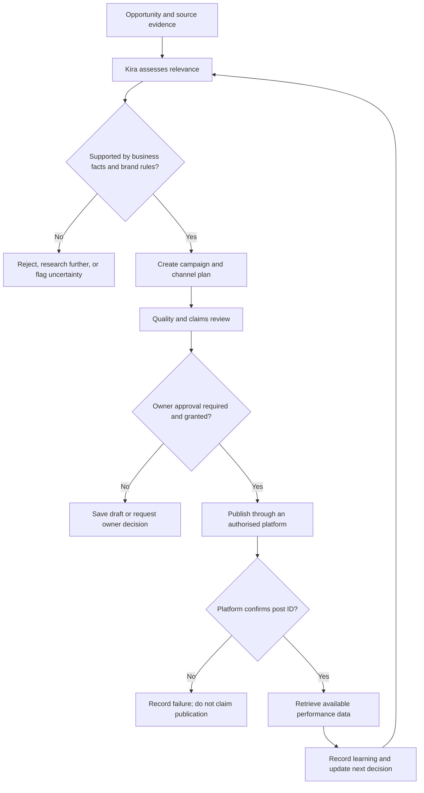
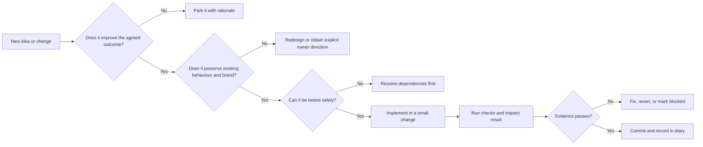

# Marketing Genius Command Centre — Build Diary

**Repository:** `lucasmaxxinfo-sketch/marketer`  
**Purpose:** A chronological, human-readable record of project decisions, implementation work, tests, failures, fixes and deployments.

This diary is the project narrative. Git commits remain the authoritative record of code changes; GitHub Actions and deployment checks remain the evidence for build and release outcomes. The diary links those records where possible and never labels unverified work as complete.

## How entries are recorded

Each entry should state:
- **Date and time:** Include the project timezone when known.
- **Objective:** What the work is intended to achieve.
- **Work performed:** What actually changed.
- **Evidence:** Commit, pull request, workflow run, test output or deployment URL.
- **Result:** Verified, partial, blocked or not yet tested.
- **Next action:** The next concrete step.

Record meaningful decisions and implementation milestones, not every trivial edit. Note regressions and their resolution rather than silently erasing them. Never put passwords, API keys, access tokens or other secrets in this diary.

---

## 2026-11-06 — Project management and baseline audit

**Objective:** Establish one continuous build record and identify the real state of the existing application before changing it.

**Work performed:**
- Confirmed the existing repository: [lucasmaxxinfo-sketch/marketer](https://github.com/lucasmaxxinfo-sketch/marketer).
- Inspected the existing frontend, cinematic styling, Kira character and voice files, PWA files, backend Worker and deployment workflow definitions.
- Confirmed the established cosmic/Kira creative direction must be preserved. A replacement generic dashboard is explicitly out of scope.
- Created [docs/BUILD-STATUS.md](./BUILD-STATUS.md), documenting the repository inventory, conditional capabilities, known implementation gaps and staged delivery sequence.
- Committed the audit as [e542164](https://github.com/lucasmaxxinfo-sketch/marketer/commit/e54216435ae7e019e1cb17638bf0aa4de13fd5e5).

**Findings from source inspection:**
- The frontend contains campaign, review, planning, business setup and local draft workflows.
- The Worker defines owner authentication, campaign storage endpoints, AI chat/strategy/generation, Facebook and Instagram publishing, and limited Facebook insights.
- Several live capabilities depend on Cloudflare Worker configuration and secrets. The tracked Wrangler configuration contains a KV namespace placeholder; the deployment workflow may inject configuration at runtime, which cannot be confirmed from source inspection alone.
- The Worker publishing code requires explicit owner approval. Its supported publishing paths are currently Facebook Page feed posts and Instagram feed image posts.
- Timed autonomous publishing, TikTok publishing, Google Business Profile publishing and broad cross-platform analytics are not established by the inspected Worker code.

**Result:** Baseline source audit recorded and committed. This is not a live deployment or end-to-end functionality test. Production service health, credentials, connected accounts and actual publishing remain unverified.

**Next action:** Verify the deployed Pages site and Worker health endpoint, then test secure owner login, AI generation, cloud persistence and publishing in a controlled environment. Record actual workflow results and evidence here.

---

## Project map

The map shows the intended operating relationships. It is an architecture model, not evidence that every integration is live.

## Decision register

| ID | Decision | Reason | Consequence | Status |
|---|---|---|---|---|
| ADR-001 | Continue in the existing `lucasmaxxinfo-sketch/marketer` repository | Preserve established work and avoid competing builds | All changes are incremental and committed to this repository | Accepted |
| ADR-002 | Preserve the cosmic environment and Kira-centred creative direction | This is the established product identity in the source | No generic dashboard replacement | Accepted |
| ADR-003 | Owner approval remains mandatory for public publishing | Publishing is externally consequential and brand-sensitive | Drafting may be autonomous; public posting is gated | Accepted |
| ADR-004 | Never infer successful publishing from an attempted API call | Platform confirmation is the evidence of publication | Require a returned provider post ID before marking published | Accepted in current Worker |
| ADR-005 | Do not treat date-only planning as a publishing schedule | A date without a safe posting time and timezone is insufficient | Automated timed publishing remains out of scope until queue semantics are implemented | Accepted |
| ADR-006 | Keep source-code presence separate from live-service verification | Secrets, account permissions and deployment state are not visible in repository source | Every capability receives a tested status and evidence link | Accepted |

## Decision quality gate

## Current delivery view

| Workstream | Evidence-based state | Next decision or action |
|---|---|---|
| Existing frontend and Kira presentation | Source files present | Browser/device QA against the deployed experience |
| Campaign drafts and review | Implemented in frontend source | Exercise end-to-end with a real campaign record |
| Cloud API and owner login | Worker source and deployment workflow present; live state unverified | Verify deployment, health and authentication |
| AI campaign generation | Worker route present; requires server configuration | Verify configured provider and run a controlled generation test |
| Facebook and Instagram publishing | Worker paths present; require Meta credentials and permissions | Verify account setup, approval gate and provider confirmation |
| Timed autonomous publishing | Not implemented as a live scheduler; cron list is empty | Design queue, timezone, posting time, retries and idempotency before enabling |
| TikTok and Google Business publishing | Not implemented in inspected Worker | Assess platform APIs and permissions before implementation |
| Analytics | Limited Facebook insights route present | Test provider response and define metric coverage |

## Visual evidence and metrics policy

- Use architecture diagrams to explain relationships, not to imply deployment status.
- Use charts only when there are actual measured values and a stated source, date range and unit.
- Keep targets, forecasts, manually entered results and platform-retrieved metrics visually distinct.
- Every decision entry must link to evidence where possible: commit, test run, issue, deployment or provider response.
- Never create illustrative values that could be mistaken for business performance.

## Standard decision record

Each significant decision should use this structure:

1. **Context:** What problem or opportunity prompted the decision?
2. **Options considered:** What realistic alternatives were evaluated?
3. **Decision:** What was selected?
4. **Rationale:** Why is it the strongest option?
5. **Risks and trade-offs:** What could go wrong or be deferred?
6. **Verification:** What evidence will prove the decision worked?
7. **Review trigger:** What new evidence would justify changing it?

---

## Ongoing project log

New entries are appended below in reverse chronological order. Each entry must distinguish source-code presence from successful live operation.
